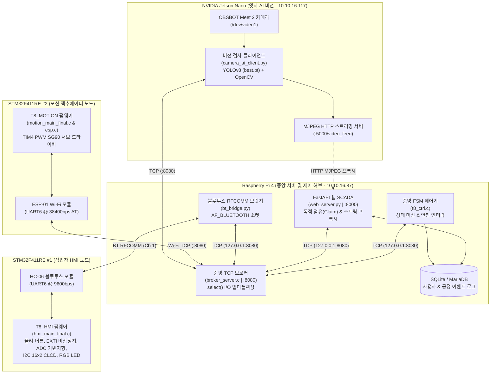

# 스마트 팩토리 AI 비전 품질 검사 및 자동 분류 시스템 (Project T8)

> 🌐 **Language**: [English](./README.md) | **[한국어](./README.ko.md)**

실시간 제품 품질 검사 및 물리적 분류 자동화를 위해 설계된 엔드투엔드(End-to-End) 산업용 IoT 및 엣지 AI 시스템입니다. **듀얼 STM32F4 마이크로컨트롤러**, **NVIDIA Jetson Nano (YOLOv8 Edge AI)**, **Raspberry Pi 4 (C TCP 메시지 브로커, 중앙 FSM 제어기, FastAPI 웹 SCADA)**를 결합한 분산 이기종 아키텍처로 구축되었습니다.

---

## 1. 시스템 아키텍처 및 네트워크 토폴로지

본 시스템은 **TCP/IP (Wi-Fi / Ethernet)** 및 **Bluetooth Classic (RFCOMM)** 통신망을 통해 6개의 하드웨어 및 소프트웨어 노드를 중앙 논블로킹 C 소켓 브로커로 통합 연결합니다.



### 노드별 구성 요약

| 노드 ID | 하드웨어 / 플랫폼 | 구현 언어 및 파일 | 통신 인터페이스 & 포트 | 핵심 역할 |
| :--- | :--- | :--- | :--- | :--- |
| **`SERVER`** | Raspberry Pi 4 | C (`broker_server.c`) | TCP Server (`0.0.0.0:8080`) | 논블로킹 `select()` 패킷 라우터, 클라이언트 인증 및 온/오프라인 이벤트 브로드캐스트 |
| **`T8_CTRL`** | Raspberry Pi 4 | C (`t8_ctrl.c`) | TCP Client (`127.0.0.1:8080`) | 중앙 유한 상태 머신(FSM), 안전 인터락, 서보 진동 억제 필터 및 공정 이력 로깅 |
| **`T8_WEB`** | Raspberry Pi 4 | Python FastAPI (`web_server.py`) | TCP (`:8080`), HTTP (`:8000`) | 웹 SCADA 대시보드, 단일 작업자 독점 점유(Claim Lock) 인증, 보안 카메라 스트림 프록시 |
| **`T8_HMI`** | STM32F411RE + HC-06 | C / STM32 HAL (`hmi_main_final.c`) | BT RFCOMM (Ch 1, 9600 bps) ↔ `bt_bridge.py` | 작업자 물리 제어 패널 (버튼 4종, EXTI 비상정지, 16x2 CLCD, RGB LED, ADC 가변저항) |
| **`T8_MOTION`** | STM32F411RE + ESP-01 | C / STM32 HAL (`motion_main_final.c`) | Wi-Fi TCP Client (`10.10.16.87:8080`) | SG90 서보모터 구동(`TIM4` 50Hz PWM), 자동 양/불량 배출 및 수동 트레이 각도 제어 |
| **`T8_VISION`** | Jetson Nano + OBSBOT | Python (`camera_ai_client.py`) | TCP (`:8080`), HTTP (`:5000`) | 동적 ROI 기반 실시간 YOLOv8 추론, 10프레임 연속 확정 판정 및 MJPEG 영상 송출 |

---

## 2. 디렉토리 구조

```text
iot_classifier/
├── iotserver/                        # Raspberry Pi 4 중앙 서버 및 웹 SCADA
│   ├── include/
│   │   ├── protocol.h                # 공통 프로토콜 상수, 클라이언트 ID 및 FSM 상태 정의
│   │   └── db_manager.h              # 이벤트 로깅 인터페이스 헤더
│   ├── src/
│   │   ├── broker_server.c           # 논블로킹 select() 기반 중앙 TCP 브로커 (:8080)
│   │   ├── t8_ctrl.c                 # 중앙 FSM 제어기 및 하드웨어 인터락 매니저
│   │   └── db_manager.c              # 타임스탬프 기반 파일 및 DB 이벤트 로거
│   ├── templates/
│   │   └── index.html                # 실시간 SCADA 웹 대시보드 프론트엔드 UI
│   ├── bt_bridge.py                  # 리눅스 네이티브 블루투스 RFCOMM ↔ TCP 브릿지 데몬
│   ├── web_server.py                 # FastAPI 백엔드, 점유권(Claim) 관리 및 MJPEG 보안 프록시
│   ├── reset_smart_factory.sql       # MariaDB / SQLite 데이터베이스 초기화 스크립트
│   ├── requirements.txt              # 라즈베리 파이 서버 Python 패키지 의존성 목록
│   └── Makefile                      # C 브로커 및 제어기 빌드용 Makefile
│
├── jetsonclient/                     # NVIDIA Jetson Nano 엣지 AI 비전 노드
│   ├── camera_ai_client.py           # YOLOv8 ROI 추론기, TCP 클라이언트 및 MJPEG 스트리머
│   ├── best.pt                       # 커스텀 학습된 YOLOv8 가중치 (정상 큐브 및 불량 검출)
│   └── requirements.txt              # Jetson Nano 클라이언트 Python 패키지 의존성 목록
│
├── stm_board/                        # STM32F411RE Bare-Metal / HAL C 펌웨어
│   ├── hmi_stm_inc_src/              # 보드 #1: 작업자 물리 제어 패널 (T8_HMI)
│   │   ├── Inc/                      # 헤더 파일 (main.h, clcd.h, HAL 설정)
│   │   └── Src/
│   │       ├── hmi_main_final.c      # 버튼 디바운싱, EXTI E-STOP 래치, ADC 가변저항, BT 링 큐
│   │       └── clcd.c                # I2C PCF8574 16x2 캐릭터 LCD 드라이버 (4비트 모드)
│   └── motion_stm_inc_src/           # 보드 #2: 모션 서보 액추에이터 (T8_MOTION)
│       ├── Inc/                      # 헤더 파일 (main.h, esp.h, HAL 설정)
│       └── Src/
│           ├── motion_main_final.c   # TIM4 PWM 서보 제어 및 논블로킹 자동 복귀 타이머
│           └── esp.c                 # ESP-01 AT 명령어 드라이버 및 +IPD 바이트 파서 상태 머신
│
├── .gitignore
├── README.md                         # 영문 프로젝트 명세서 (English)
└── README.ko.md                      # 국문 프로젝트 명세서 (한국어)
```

---

## 3. 브로커 통신 프로토콜 규격

모든 노드 간 통신은 `broker_server`를 경유하며 개행 문자(`\n`)로 구분되는 ASCII 텍스트 패킷을 사용합니다.

### 3.1. 핸드셰이크 및 클라이언트 인증
포트 `8080`에 TCP 소켓 연결 직후, 모든 클라이언트는 최초 1회 인증 패킷을 전송해야 합니다:
```text
[클라이언트ID:PASSWD]\n
```
* **유효 클라이언트 ID**: `T8_CTRL`, `T8_WEB`, `T8_HMI`, `T8_MOTION`, `T8_VISION`
* 인증 성공 시 브로커는 웹 대시보드(`T8_WEB`)로 `NODE_EVENT@<ID>@ONLINE\n`을 브로드캐스트하며, 연결 종료 시 `OFFLINE`을 즉시 통보합니다.
* 무선 구간 재접속 등으로 인해 동일 ID가 중복 접속할 경우, 브로커가 기존 좀비 소켓을 자동으로 정리하고 새 소켓으로 세션을 갱신합니다.

### 3.2. 패킷 라우팅 규칙
* **클라이언트 송신 포맷**: `[목적지ID]명령어@인자\n`
* **브로커 변환 및 전달**: 브로커는 송신자의 인증된 ID로 헤더를 재작성하여 목적지 소켓에 `[발신자ID]명령어@인자\n` 형태로 포워딩합니다.

### 3.3. 전체 제어 명령어 레퍼런스

| 분류 | 패킷 포맷 | 송신 → 수신 | 상세 동작 설명 |
| :--- | :--- | :--- | :--- |
| **공정 제어** | `[T8_CTRL]START\n` | HMI / Web → CTRL | 자동 검사 공정 시작 (`READY` → `WORKING`) |
| | `[T8_CTRL]END\n` | HMI / Web → CTRL | 현재 공정 정지 및 대기 상태(`READY`) 복귀 |
| | `[T8_CTRL]RESET\n` | Web → CTRL | 비상 정지(ESTOP) 해제 또는 시스템 상태 초기화 |
| | `[T8_CTRL]MODE@AUTO\n` | HMI / Web → CTRL | 자동 비전 분류 모드로 전환 및 서보 원점(`90°`) 정렬 |
| | `[T8_CTRL]MODE@MANUAL\n` | HMI / Web → CTRL | 수동 점검 모드로 전환 (가변저항 및 웹 슬라이더 조작 활성화) |
| | `[T8_CTRL]SYNC\n` | HMI / Web → CTRL | 현재 상태 일괄 동기화 요청 (`STATE`, `MODE`, `TRAY`) |
| **서보 및 모션** | `[T8_CTRL]TRAY@<0~180>\n` | HMI / Web → CTRL | 수동 모드 트레이 서보모터 목표 각도(`0°~180°`) 제어 요청 |
| | `[T8_MOTION]TRAY@<0~180>\n` | CTRL → MOTION | SG90 서보모터를 지정 각도로 즉시 구동 |
| | `[T8_MOTION]HOME\n` | CTRL → MOTION | 분류 트레이를 수평 원점(`90°`)으로 정렬 |
| | `[T8_MOTION]SORT@PASS\n` | CTRL → MOTION | 양품 배출: `150°` 회전 → `1,000 ms` 유지 → `90°`(`HOME`) 자동 복귀 |
| | `[T8_MOTION]SORT@FAIL\n` | CTRL → MOTION | 불량 배출: `30°` 회전 → `1,000 ms` 유지 → `90°`(`HOME`) 자동 복귀 |
| | `[T8_CTRL]SORT_DONE@PASS\n` | MOTION → CTRL | 양품 물리 배출 및 원점 복귀 완료 피드백 전송 |
| | `[T8_CTRL]SORT_DONE@FAIL\n` | MOTION → CTRL | 불량 물리 배출 및 원점 복귀 완료 피드백 전송 |
| **AI 비전 검사** | `[T8_VISION]UNLOCK\n` | Web → VISION | 작업자 제어권 점유(Claim) 시 카메라 활성화 및 추론 인가 |
| | `[T8_VISION]LOCK\n` | Web → VISION | 점유 반납 또는 만료 시 카메라 잠금 및 보안 대기 화면 송출 |
| | `[T8_CTRL]CHECK\n` | HMI / VISION → CTRL | ROI 내 검사 대상 진입 감지 (`WORKING` → `INSPECTING` 전이) |
| | `[T8_CTRL]NORMAL\n` (`PASS`) | VISION → CTRL | 양품 판정 확정 송출 (신뢰도 65% 이상 10프레임 연속 검출) |
| | `[T8_CTRL]DEFECT\n` (`FAIL`) | VISION → CTRL | 불량 판정 확정 송출 (결함 신뢰도 35% 이상 10프레임 연속 검출) |
| | `[T8_VISION]ACT@DONE\n` | CTRL → VISION | 서보모터 물리 분류 완료 통보 (비전 노드의 다음 검사 대기 해제) |
| **비상 정지 인터락** | `[T8_CTRL]ESTOP\n` | HMI / Web → CTRL | 전 계통 즉시 비상 정지 발령 (`STATE_ESTOP` 진입) |
| | `[T8_CTRL]ESTOP_CLEAR\n` | HMI → CTRL | 물리 `END` 버튼을 2.0초 이상 길게 누를 때 해제 요청 송출 |
| | `[T8_HMI]ESTOP_CLEARED\n` | CTRL → HMI | 제어기의 해제 승인 ACK (수신 시에만 HMI 물리 버튼 락 해제) |

---

## 4. 핵심 서브시스템 엔지니어링 상세

### 4.1. 중앙 FSM 제어기 (`iotserver/src/t8_ctrl.c`)
* **상태 머신 파이프라인**: `READY` → `WORKING` → `INSPECTING` → `PASS` / `FAIL` → `WORKING`(연속 순환 공정) 및 `MANUAL`, `ESTOP` 상태를 중앙 집중 관리합니다.
* **수동 모드 서보 요동 방지 3단 필터 (Anti-Oscillation Pipeline)**:
  1. **에코 무한 루프 차단 (`from_id == CLIENT_MOTION`)**: 모션 보드가 동작 후 확인용으로 회신한 `TRAY@` 패킷이 다시 모션 보드로 재전송되어 발생하는 패킷 핑퐁 폭풍(Echo Storm)을 원천 차단합니다.
  2. **소프트웨어 데드밴드 필터 (`±3°`)**: HMI 12비트 ADC 가변저항의 전원 리플 및 블루투스 RF 노이즈로 인한 미세 각도 떨림을 필터링합니다.
  3. **전송 주기 스로틀링 (`150 ms` Rate Limiting)**: ESP-01 Wi-Fi 모듈의 블로킹 `AT+CIPSEND` 처리 지연을 고려하여 최소 150ms 간격으로 송신 주기를 제한합니다.

### 4.2. 작업자 HMI 보드 펌웨어 (`stm_board/hmi_stm_inc_src/Src/hmi_main_final.c`)
* **인터럽트 안전(ISR-Safe) 설계**:
  * **UART6 링 큐(`btRxQueue[16][64]`)**: HC-06 블루투스 수신 인터럽트(`HAL_UART_RxCpltCallback`)에서는 바이트 조립 후 16슬롯 원형 큐에 적재만 수행하고, 문자열 파싱 및 I2C CLCD 제어는 메인 루프에서 순차 처리합니다.
  * **하드웨어 E-STOP 래치 (`PC13` EXTI 하강 엣지)**: 인터럽트 즉시 `estopLatched = 1`로 모든 버튼과 가변저항을 잠급니다. 해제를 위해서는 `END` 버튼(`PB2`)을 **2,000 ms 이상 롱프레스**하여 `[T8_CTRL]ESTOP_CLEAR\n`를 보내고, 중앙 제어기로부터 `[T8_CTRL]ESTOP_CLEARED\n` 응답을 받아야만 잠금이 풀리는 양방향 안전 인터락을 구현했습니다.
* **가변저항 조그 제어 (`PA0` / `ADC1_IN0`)**: `MANUAL` 모드에서 `200 ms` 주기로 12비트 ADC(`0~4095`)를 샘플링하며, 하드웨어 불감대(`POT_DEADBAND = 50`)를 초과할 때 `0°~180°`로 선형 매핑하여 송출합니다.
* **시각 피드백**: `I2C3` 기반 `PCF8574` 16x2 캐릭터 LCD(주소 `0x27`, 4비트 분할 전송)와 상태별 RGB LED(`PB13`, `PB14`, `PB15`) 점멸을 구동합니다.

### 4.3. 모션 액추에이터 보드 펌웨어 (`stm_board/motion_stm_inc_src/Src/motion_main_final.c` & `esp.c`)
* **SG90 서보 PWM 정밀 제어 (`PB6` / `TIM4_CH1`)**:
  * `84 MHz` 타이머 클럭을 `PSC = 84 - 1`, `ARR = 20000 - 1`로 분주하여 **50 Hz (`20 ms` 주기, `1 tick = 1 µs`)** 제어 신호를 생성합니다.
  * 펄스폭 매핑: `0° = 650 µs`, `90°(HOME) = 1,575 µs`, `180° = 2,500 µs`.
  * 분류 각도: **불량(`FAIL`) = `30°`**, **수평 대기(`HOME`) = `90°`**, **양품(`PASS`) = `150°`**.
* **논블로킹 자동 복귀 타이머**: `SORT@PASS` 또는 `SORT@FAIL` 수신 시 배출 각도로 회전 후 `HAL_Delay()`로 멈추지 않고 `sortStartTick = HAL_GetTick()`을 기록합니다. 메인 루프에서 `1,000 ms` 경과를 비동기 감시하여 원점(`90°`) 복귀 및 `SORT_DONE` 보고를 수행함으로써 대기 중에도 비상 정지(`ESTOP`) 명령을 즉각 수용합니다.
* **`+IPD` 바이트 스트림 파서 (`esp.c`)**: ESP-01 모듈의 비동기 수신 프레임(`+IPD,<길이>:<페이로드>`)을 UART6 ISR 내부에서 4단계 상태 머신(`IPD_WAIT` → `IPD_PREFIX` → `IPD_LENGTH` → `IPD_PAYLOAD`)으로 파싱하여 패킷 유실을 방지합니다.

### 4.4. 엣지 AI 비전 노드 (`jetsonclient/camera_ai_client.py`)
* **동적 중앙 ROI 검사**: 영상 해상도 중앙에 `220 × 220 px` 관심 영역(ROI)을 설정하고, 검출된 객체 바운딩 박스의 중심점 `(cx, cy)`가 ROI 내부에 진입했을 때만 판정을 수행합니다.
* **다중 프레임 연속 판정 (Streak Confirmation)**:
  * 커스텀 학습된 YOLOv8 모델(`best.pt`)을 사용하여 정상 큐브(`box`, 신뢰도 ≥ 0.65)와 결함(`defect`, 신뢰도 ≥ 0.35)을 분류합니다.
  * 일시적인 모션 블러나 조명 노이즈에 의한 오판정을 막기 위해 **동일 결과가 10프레임 연속(`REQUIRED_STREAK = 10`) 누적**될 때만 최종 판정(`NORMAL` / `DEFECT`)을 송출합니다.
* **보안 카메라 락**: 웹 SCADA에서 제어권을 점유(`UNLOCK`)하지 않은 상태에서는 카메라 추론을 중단하고 보안 대기 화면을 송출합니다.

### 4.5. 웹 SCADA 대시보드 (`iotserver/web_server.py`)
* **단일 작업자 독점 점유 (Exclusive Claim Lock)**: 다중 접속 환경에서 조작 충돌을 방지하기 위해 한 번에 단 1명의 인증된 작업자만 5분간 제어권을 점유할 수 있으며, 시간 만료 또는 로그아웃 시 즉시 잠금 상태로 복귀합니다.
* **사전 설비 연결 검증 (Pre-Flight Check)**: 4대 핵심 노드(`T8_CTRL`, `T8_HMI`, `T8_MOTION`, `T8_VISION`) 중 하나라도 오프라인이면 제어권 점유를 원천 차단합니다.

---

## 5. 빌드 및 실행 가이드

### 5.1. Raspberry Pi 4 서버 (`iotserver/`)

1. **C 브로커 및 중앙 제어기 컴파일**:
   ```bash
   cd iotserver
   make clean && make
   ```
   빌드 완료 시 `./build/broker_server`와 `./build/t8_ctrl` 실행 파일이 생성됩니다.

2. **Python 가상환경 생성 및 패키지 설치**:
   ```bash
   python3 -m venv venv
   source venv/bin/activate
   pip install -r requirements.txt
   ```

3. **서버 프로세스 기동** (개별 터미널 또는 `tmux` / `systemd` 실행):
   ```bash
   # 터미널 1: 중앙 TCP 브로커 실행 (:8080)
   ./build/broker_server 8080

   # 터미널 2: 중앙 FSM 제어기 실행
   ./build/t8_ctrl 127.0.0.1 8080

   # 터미널 3: 블루투스 RFCOMM 브릿지 실행 (HC-06 연결)
   python3 bt_bridge.py

   # 터미널 4: FastAPI 웹 SCADA 서버 실행 (:8000)
   python3 web_server.py
   ```
   * **웹 대시보드 접속 주소**: `http://<라즈베리파이_IP>:8000`
   * **기본 관리자 계정**: `admin` / `admin1234`

### 5.2. NVIDIA Jetson Nano 비전 클라이언트 (`jetsonclient/`)

1. **의존성 설치 및 비전 클라이언트 실행**:
   ```bash
   cd jetsonclient
   pip3 install -r requirements.txt
   python3 camera_ai_client.py
   ```
   * `10.10.16.87:8080` 브로커에 `T8_VISION`으로 접속하며, `http://0.0.0.0:5000/video_feed`로 실시간 추론 영상을 스트리밍합니다.

### 5.3. STM32F411RE 보드 (`stm_board/`)
1. **STM32CubeIDE**에서 `stm_board/hmi_stm_inc_src`(보드 #1) 및 `stm_board/motion_stm_inc_src`(보드 #2) 프로젝트를 가져옵니다.
2. 각 보드를 빌드한 뒤 **ST-Link**를 통해 플래싱합니다.

---

## 6. 팀원 및 담당 역할 (Contributors)

* **손준호 (Junho Son) — 임베디드 펌웨어 엔지니어**
  * 듀얼 STM32F411RE Bare-Metal / HAL C 펌웨어(`stm_board/`) 전체 설계 및 구현
  * `T8_HMI`(`hmi_main_final.c`, `clcd.c`) 개발: 물리 버튼 디바운싱, EXTI 비상정지 인터럽트 래치, 12비트 ADC 가변저항 조그 제어, I2C CLCD 드라이버 및 블루투스 원형 수신 큐 구현
  * `T8_MOTION`(`motion_main_final.c`, `esp.c`) 개발: ESP-01 Wi-Fi AT 커맨드 드라이버, 바이트 단위 `+IPD` 패킷 파서, `TIM4` PWM SG90 서보 제어 로직 구현
* **정승헌 (Seungheon Jeong) — 시스템 아키텍트, 엣지 AI & 풀스택 엔지니어**
  * 중앙 리눅스 서버 아키텍처 및 웹 SCADA 플랫폼(`iotserver/`) 전체 설계 및 구현
  * 논블로킹 `select()` TCP 브로커(`broker_server.c`), 중앙 FSM 제어기(`t8_ctrl.c`), 네이티브 블루투스 RFCOMM 브릿지(`bt_bridge.py`), FastAPI 웹 SCADA 대시보드(`web_server.py`, `index.html`) 개발
  * Jetson Nano 기반 YOLOv8 엣지 AI 비전 검사 파이프라인 및 멀티스레드 MJPEG 스트리밍 서버(`jetsonclient/camera_ai_client.py`) 학습 및 구축
