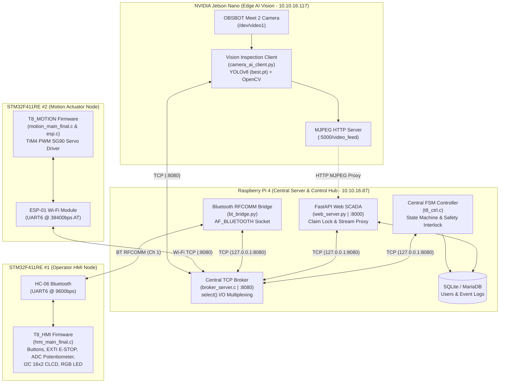

# Smart Factory AI Vision Quality Inspection & Automated Sorting System (Project T8)

An end-to-end industrial IoT & Edge AI automation system designed for real-time product quality inspection and physical sorting. Built on a distributed heterogeneous architecture combining **Dual STM32F4 Microcontrollers**, **NVIDIA Jetson Nano (YOLOv8 Edge AI)**, and **Raspberry Pi 4 (C TCP Message Broker, Central FSM Controller, and FastAPI Web SCADA)**.

---

## 1. System Architecture & Network Topology

The system connects six distributed hardware and software nodes over **TCP/IP (Wi-Fi / Ethernet)** and **Bluetooth Classic (RFCOMM)** through a centralized non-blocking C socket broker.



### Node Overview

| Node ID | Hardware / Platform | Implementation | Interface & Port | Primary Role |
| :--- | :--- | :--- | :--- | :--- |
| **`SERVER`** | Raspberry Pi 4 | C (`broker_server.c`) | TCP Server (`0.0.0.0:8080`) | Non-blocking `select()` message router, client authentication, and node lifecycle broadcasting |
| **`T8_CTRL`** | Raspberry Pi 4 | C (`t8_ctrl.c`) | TCP Client (`127.0.0.1:8080`) | Master Finite State Machine (FSM), safety interlocks, servo stabilization filter, and audit logging |
| **`T8_WEB`** | Raspberry Pi 4 | Python FastAPI (`web_server.py`) | TCP (`:8080`), HTTP (`:8000`) | Web SCADA dashboard, single-operator Claim Lock authentication, and secure camera stream proxy |
| **`T8_HMI`** | STM32F411RE + HC-06 | C / STM32 HAL (`hmi_main_final.c`) | BT RFCOMM (Ch 1, 9600 bps) ↔ `bt_bridge.py` | Physical operator control panel (tactile buttons, EXTI E-STOP, 16x2 CLCD, RGB LED, ADC potentiometer) |
| **`T8_MOTION`** | STM32F411RE + ESP-01 | C / STM32 HAL (`motion_main_final.c`) | Wi-Fi TCP Client (`10.10.16.87:8080`) | SG90 servo actuator (`TIM4` 50Hz PWM) for automated PASS/FAIL sorting and manual tray tilt control |
| **`T8_VISION`** | Jetson Nano + OBSBOT | Python (`camera_ai_client.py`) | TCP (`:8080`), HTTP (`:5000`) | Real-time YOLOv8 inference within dynamic ROI, multi-frame streak confirmation, and MJPEG streaming |

---

## 2. Repository Structure

```text
iot_classifier/
├── iotserver/                        # Raspberry Pi 4 Central Server & Web SCADA
│   ├── include/
│   │   ├── protocol.h                # Shared protocol constants, node IDs, and FSM states
│   │   └── db_manager.h              # Event logging interface
│   ├── src/
│   │   ├── broker_server.c           # Non-blocking select() TCP message broker (:8080)
│   │   ├── t8_ctrl.c                 # Central FSM controller & hardware interlock manager
│   │   └── db_manager.c              # Timestamped file & database event logger
│   ├── templates/
│   │   └── index.html                # Real-time SCADA web dashboard frontend
│   ├── bt_bridge.py                  # Native Linux Bluetooth RFCOMM-to-TCP bridge daemon
│   ├── web_server.py                 # FastAPI backend, Claim Lock manager & MJPEG security proxy
│   ├── reset_smart_factory.sql       # MariaDB / SQLite schema initialization script
│   ├── requirements.txt              # Python dependencies for Raspberry Pi server
│   └── Makefile                      # GCC build configuration for C server binaries
│
├── jetsonclient/                     # NVIDIA Jetson Nano Edge AI Vision Node
│   ├── camera_ai_client.py           # YOLOv8 ROI detector, TCP client & MJPEG HTTP streamer
│   ├── best.pt                       # Custom-trained YOLOv8 weights (Cube & Defect detection)
│   └── requirements.txt              # Python dependencies for Jetson Nano client
│
├── stm_board/                        # STM32F411RE Bare-Metal / HAL C Firmware
│   ├── hmi_stm_inc_src/              # Board #1: Operator HMI Controller (T8_HMI)
│   │   ├── Inc/                      # Header files (main.h, clcd.h, HAL configs)
│   │   └── Src/
│   │       ├── hmi_main_final.c      # Debounced buttons, EXTI E-STOP latch, ADC pot, BT RX queue
│   │       └── clcd.c                # I2C PCF8574 16x2 Character LCD driver (4-bit mode)
│   └── motion_stm_inc_src/           # Board #2: Motion Servo Actuator (T8_MOTION)
│       ├── Inc/                      # Header files (main.h, esp.h, HAL configs)
│       └── Src/
│           ├── motion_main_final.c   # TIM4 PWM servo controller & non-blocking sort return timer
│           └── esp.c                 # ESP-01 AT command driver & +IPD state-machine parser
│
├── .gitignore
└── README.md
```

---

## 3. Broker Communication Protocol

All inter-node communications use newline-delimited (`\n`) ASCII packets routed through `broker_server`.

### 3.1. Handshake & Authentication
Immediately upon establishing a TCP connection to port `8080`, every client must send a single registration packet:
```text
[CLIENT_ID:PASSWD]\n
```
* **Valid Client IDs**: `T8_CTRL`, `T8_WEB`, `T8_HMI`, `T8_MOTION`, `T8_VISION`
* Upon authentication, the broker broadcasts `NODE_EVENT@<CLIENT_ID>@ONLINE\n` to `T8_WEB` (and `OFFLINE` upon socket disconnection).
* Duplicate logins with the same ID automatically evict the stale socket descriptor to handle wireless reconnections gracefully.

### 3.2. Packet Routing Format
* **Client Transmission**: `[DESTINATION_ID]COMMAND@ARGUMENT\n`
* **Broker Forwarding**: The broker rewrites the header with the authenticated sender's ID and delivers `[SENDER_ID]COMMAND@ARGUMENT\n` to the destination socket.

### 3.3. Command Set Reference

| Category | Packet Format | Sender → Receiver | Description |
| :--- | :--- | :--- | :--- |
| **Process Control** | `[T8_CTRL]START\n` | HMI / Web → CTRL | Start automated inspection cycle (`READY` → `WORKING`) |
| | `[T8_CTRL]END\n` | HMI / Web → CTRL | Stop current cycle and return to `READY` |
| | `[T8_CTRL]RESET\n` | Web → CTRL | Clear emergency stop or reset state to `READY` |
| | `[T8_CTRL]MODE@AUTO\n` | HMI / Web → CTRL | Switch to automated vision sorting mode and home servo (`90°`) |
| | `[T8_CTRL]MODE@MANUAL\n` | HMI / Web → CTRL | Switch to manual maintenance mode (enables potentiometer & web slider) |
| | `[T8_CTRL]SYNC\n` | HMI / Web → CTRL | Request full state synchronization (`STATE`, `MODE`, `TRAY`) |
| **Servo & Motion** | `[T8_CTRL]TRAY@<0~180>\n` | HMI / Web → CTRL | Request manual servo angle adjustment (`0°` to `180°`) |
| | `[T8_MOTION]TRAY@<0~180>\n` | CTRL → MOTION | Drive SG90 servo to target angle immediately |
| | `[T8_MOTION]HOME\n` | CTRL → MOTION | Align sorting tray to neutral horizontal position (`90°`) |
| | `[T8_MOTION]SORT@PASS\n` | CTRL → MOTION | Tilt tray to `150°`, hold for `1,000 ms`, return to `90°` (`HOME`) |
| | `[T8_MOTION]SORT@FAIL\n` | CTRL → MOTION | Tilt tray to `30°`, hold for `1,000 ms`, return to `90°` (`HOME`) |
| | `[T8_CTRL]SORT_DONE@PASS\n` | MOTION → CTRL | Confirm physical completion of PASS sorting sequence |
| | `[T8_CTRL]SORT_DONE@FAIL\n` | MOTION → CTRL | Confirm physical completion of FAIL sorting sequence |
| **AI Vision** | `[T8_VISION]UNLOCK\n` | Web → VISION | Unlock camera feed and enable AI inference upon operator Claim |
| | `[T8_VISION]LOCK\n` | Web → VISION | Lock camera feed when operator releases Claim or session expires |
| | `[T8_CTRL]CHECK\n` | HMI / VISION → CTRL | Object detected in ROI; transition `WORKING` → `INSPECTING` |
| | `[T8_CTRL]NORMAL\n` (`PASS`) | VISION → CTRL | Product confirmed normal (10 consecutive frames ≥ 65% confidence) |
| | `[T8_CTRL]DEFECT\n` (`FAIL`) | VISION → CTRL | Product confirmed defective (10 consecutive frames ≥ 35% defect conf) |
| | `[T8_VISION]ACT@DONE\n` | CTRL → VISION | Notify vision node that physical sorting has completed |
| **E-STOP Interlock** | `[T8_CTRL]ESTOP\n` | HMI / Web → CTRL | Trigger immediate system-wide emergency lock (`STATE_ESTOP`) |
| | `[T8_CTRL]ESTOP_CLEAR\n` | HMI → CTRL | Sent after holding the physical `END` button for ≥ 2.0 seconds |
| | `[T8_HMI]ESTOP_CLEARED\n` | CTRL → HMI | Required controller ACK that releases the hardware E-STOP latch on HMI |

---

## 4. Core Subsystem Engineering Details

### 4.1. Central Finite State Machine (`iotserver/src/t8_ctrl.c`)
* **States**: `READY` → `WORKING` → `INSPECTING` → `PASS` / `FAIL` → `WORKING` (continuous loop), plus `MANUAL` and `ESTOP`.
* **Manual Mode Stabilization (Anti-Oscillation Pipeline)**:
  1. **Echo Loop Suppression**: Ignores feedback `TRAY@<angle>` packets originating from `T8_MOTION` when forwarding commands to the actuator, preventing infinite TCP ping-pong storms.
  2. **Software Deadband Filter (`±3°`)**: Filters out minor 12-bit ADC electrical ripple and RF noise from the HMI potentiometer.
  3. **Rate Limiting (`150 ms` Cooldown)**: Throttles outbound `TRAY@` packets to prevent UART/AT command buffer congestion on the ESP-01 Wi-Fi module.

### 4.2. Operator HMI Firmware (`stm_board/hmi_stm_inc_src/Src/hmi_main_final.c`)
* **Interrupt-Safe Architecture**:
  * **UART6 RX Ring Queue**: Incoming HC-06 Bluetooth packets are buffered in a 16-slot circular queue (`btRxQueue[16][64]`) inside `HAL_UART_RxCpltCallback` and parsed sequentially in the main loop without blocking interrupts.
  * **Hardware E-STOP (`PC13` EXTI Falling-Edge)**: Sets `estopLatched = 1` and `estopEvent = 1` immediately in the ISR. Recovery requires a **2,000 ms long-press** on the `END` button (`PB2`) to transmit `[T8_CTRL]ESTOP_CLEAR\n`, and the physical lock is only released after receiving `[T8_CTRL]ESTOP_CLEARED\n` from the central controller.
* **Potentiometer Jogging (`PA0` / `ADC1_IN0`)**: Samples 12-bit ADC (`0–4095`) every `200 ms` in `MANUAL` mode, applies a hardware deadband (`POT_DEADBAND = 50`), and maps values linearly to `0°–180°`.
* **Visual Feedback**: Drives a 16x2 I2C Character LCD (`PCF8574` at address `0x27` on `I2C3`) and a common-cathode RGB LED (`PB13`, `PB14`, `PB15`).

### 4.3. Motion Actuator Firmware (`stm_board/motion_stm_inc_src/Src/motion_main_final.c` & `esp.c`)
* **SG90 Servo PWM Generation (`TIM4_CH1` on `PB6`)**:
  * Configured at **50 Hz (`20 ms` period)** with `PSC = 84 - 1` and `ARR = 20000 - 1` (`1 tick = 1 µs`).
  * Pulse width mapping: `0° = 650 µs`, `90° (HOME) = 1,575 µs`, `180° = 2,500 µs`.
  * Sorting angles: **FAIL = `30°`**, **HOME = `90°`**, **PASS = `150°`**.
* **Non-Blocking Auto-Return Timer**: Upon receiving `SORT@PASS` or `SORT@FAIL`, the MCU moves the servo to the target discharge angle, records `sortStartTick = HAL_GetTick()`, and uses a non-blocking `1,000 ms` timer in the main loop to return the tray to `90°` and transmit `SORT_DONE` while keeping the ESP-01 receiver active.
* **Byte-Level `+IPD` State Machine (`esp.c`)**: Parses asynchronous ESP-01 TCP frames (`IPD_WAIT` → `IPD_PREFIX` → `IPD_LENGTH` → `IPD_PAYLOAD`) byte-by-byte inside the UART6 ISR so incoming network commands are never lost during AT command handshakes.

### 4.4. Edge AI Vision Node (`jetsonclient/camera_ai_client.py`)
* **Dynamic ROI Inspection**: Computes a centered `220 × 220 px` Region of Interest (`ROI`) and evaluates detections whose bounding-box center `(cx, cy)` falls inside the ROI.
* **Multi-Frame Streak Verification**:
  * Classifies detections using custom YOLOv8 weights (`best.pt`).
  * Requires **10 consecutive consistent frames** (`REQUIRED_STREAK = 10`) meeting confidence thresholds (`BOX_CONF_THRESHOLD = 0.65`, `DEFECT_CONF_THRESHOLD = 0.35`) before dispatching `NORMAL` or `DEFECT` to `T8_CTRL`.
* **Security Lock & Privacy Shield**: Blocks camera inference and replaces the MJPEG stream with an encrypted standby slate whenever no operator holds an active Web SCADA Claim lock.

### 4.5. Web SCADA Dashboard (`iotserver/web_server.py`)
* **Single-Operator Exclusive Claim Lock**: Only one authenticated operator can claim control of the factory at a time (5-minute lease with automatic expiration and `UNLOCK`/`LOCK` camera synchronization).
* **Pre-Flight Readiness Check**: Blocks control acquisition if any required hardware node (`T8_CTRL`, `T8_HMI`, `T8_MOTION`, `T8_VISION`) is offline.

---

## 5. Build & Deployment Guide

### 5.1. Raspberry Pi 4 (`iotserver/`)

1. **Compile the C Broker and FSM Controller**:
   ```bash
   cd iotserver
   make clean && make
   ```
   This builds `./build/broker_server` and `./build/t8_ctrl`.

2. **Install Python Dependencies**:
   ```bash
   python3 -m venv venv
   source venv/bin/activate
   pip install -r requirements.txt
   ```

3. **Run the Server Stack** (in separate terminals or via `systemd` / `tmux`):
   ```bash
   # Terminal 1: Start Central TCP Broker (:8080)
   ./build/broker_server 8080

   # Terminal 2: Start Central FSM Controller
   ./build/t8_ctrl 127.0.0.1 8080

   # Terminal 3: Start Bluetooth RFCOMM Bridge (connects to HC-06)
   python3 bt_bridge.py

   # Terminal 4: Start FastAPI Web SCADA Server (:8000)
   python3 web_server.py
   ```
   * **Web Dashboard URL**: `http://<RASPBERRY_PI_IP>:8000`
   * **Default Administrator Credentials**: `admin` / `admin1234`

### 5.2. NVIDIA Jetson Nano (`jetsonclient/`)

1. **Install Dependencies & Start Vision Client**:
   ```bash
   cd jetsonclient
   pip3 install -r requirements.txt
   python3 camera_ai_client.py
   ```
   * Connects to the broker at `10.10.16.87:8080` as `T8_VISION` and serves the annotated MJPEG stream at `http://0.0.0.0:5000/video_feed`.

### 5.3. STM32F411RE Boards (`stm_board/`)
1. Open **STM32CubeIDE** and import `stm_board/hmi_stm_inc_src` (Board #1) and `stm_board/motion_stm_inc_src` (Board #2).
2. Build and flash each board via **ST-Link**.

---

## 6. Contributors & Roles

* **Junho Son (손준호) — Embedded Firmware Engineer**
  * Designed and implemented the STM32F411RE bare-metal / HAL C firmware (`stm_board/`).
  * Developed `T8_HMI` (`hmi_main_final.c`, `clcd.c`): hardware button debouncing, EXTI E-STOP interrupt latching, 12-bit ADC potentiometer jogging, I2C CLCD driver, and interrupt-driven Bluetooth RX circular queue.
  * Developed `T8_MOTION` (`motion_main_final.c`, `esp.c`): custom ESP-01 Wi-Fi AT command driver, byte-level `+IPD` packet parser, and `TIM4` PWM SG90 servo control logic.
* **Seungheon Jeong (정승헌) — System Architect, Edge AI & Full-Stack Engineer**
  * Designed and implemented the central Linux server architecture and Web SCADA platform (`iotserver/`).
  * Developed the non-blocking `select()` TCP broker (`broker_server.c`), central FSM controller (`t8_ctrl.c`), native Bluetooth RFCOMM bridge (`bt_bridge.py`), and FastAPI SCADA dashboard (`web_server.py`, `index.html`).
  * Trained and deployed the YOLOv8 Edge AI inspection pipeline and multi-threaded MJPEG streaming server on Jetson Nano (`jetsonclient/camera_ai_client.py`).